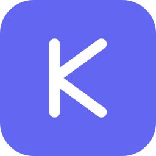

# Karsa Studio

<p align="center">
  
</p>

<p align="center">
  <strong>Modern, Lightning-Fast, 100% Client-Side Text-to-Diagram Studio</strong>
</p>

<p align="center">
  <a href="README.md">English</a> •
  <a href="README.id.md">Bahasa Indonesia</a> •
  <a href="README.zh.md">中文 (Mandarin)</a> •
  <a href="README.ja.md">日本語 (Japanese)</a> •
  <a href="README.ru.md">Русский (Russian)</a>
</p>

<p align="center">
  
  
  
  
  
</p>

---

**Karsa Studio** is a full-featured, professional *Text-to-Diagram* editor released as **Open Source (Non-Commercial)**. It runs entirely inside your browser (100% Client-Side), meaning no diagram data ever leaves your device. Designed to bridge the gap between technical code-based diagramming and modern design tools like Figma, Karsa Studio empowers software engineers, system architects, product managers, and technical writers to turn ideas and architectures into polished visual diagrams in seconds.

🌐 **Live Application:** [karsa-studio.rivaldigunawanyusuf.com](https://karsa-studio.rivaldigunawanyusuf.com)

---

## 🚀 Key Highlights & Features

### 🔒 100% Client-Side, Private & Offline-First (PWA)
- **Zero Server Latency:** Diagram rendering and syntax parsing are executed locally via Web Workers and browser JavaScript.
- **Privacy by Design:** Your sensitive architecture diagrams, database schemas, and proprietary logic never touch third-party servers.
- **Progressive Web App (PWA):** Installable as a standalone desktop or mobile application. Works fully offline with zero internet connectivity.

### 🎨 Figma-Style Interactive Canvas
- **Space + Drag Pan:** Hold `Space` and drag with your mouse/pointer to smoothly glide across infinite canvas space, just like in Figma or Miro.
- **Intuitive Zooming:** Smooth zoom with `Ctrl/Cmd + Wheel`, trackpad pinch gestures, or on-screen zoom controls.
- **Viewport Helpers:** Instant 1:1 view (`Cmd/Ctrl + 1`) and Fit-to-Screen (`Cmd/Ctrl + 0` or canvas double-click).
- **Customizable Canvas Backgrounds:** Switch between Dots, Grid, Plain, and Transparent canvas styles with theme-matching contrast.

### 💻 Advanced CodeMirror 6 Editor
- **Modern Syntax Highlighting & Validation:** Live syntax error detection with inline line markers and instant error alerts.
- **Desktop & Mobile Scrolling:** Flawlessly bounded scroll containers with smooth mouse wheel, trackpad, and touch momentum scrolling.
- **Quick Insert Toolbar:** One-click insertion for Nodes, Decision Diamonds, Subgraphs, Databases, Circles, Dotted Links, and Thick Arrows.
- **Pro Typing Utilities:** Multi-cursor selection (`Alt + Click`), block code folding, bracket auto-closing, comment toggling (`Cmd/Ctrl + /`), and find-and-replace (`Cmd/Ctrl + F`).
- **Flexible Layout:** Live split-pane with draggable resize splitter, horizontal/vertical orientation toggle, and single-click full editor / full preview focus modes.

### 📚 24 Built-In Industry Diagram Templates
Ready-to-use, cleanly formatted templates organized by category:
1. **Flowcharts & Process:** Standard Flowchart, Architecture Flowchart (LR), State Machine.
2. **Databases & Code:** Relational Database ERD (PK/FK), OOP Class Diagram, Requirements Traceability, Network Packet Byte Layout.
3. **Interactions & Systems:** Sequence Diagram (Authentication Flow), Cloud Architecture, C4 System Context, Freeform Block Diagram.
4. **Planning & Roadmap:** Gantt Project Schedule, Product History Timeline, User Journey Map, Kanban Task Board, Git Branching & Merge Graph.
5. **Analytics & Data:** Pie Distribution Chart, XY Bar/Line Metric Graph, Quadrant 2x2 Priority Matrix, Sankey Resource Flow, Radar/Spider Attribute Chart, Treemap Hierarchy.
6. **Ideation:** Hierarchical Mindmap and Blank Starter Canvas.

### 🎭 Visual Themes & Custom Styling Engine
- **Light & Dark Modes:** Seamlessly toggles between sleek dark glassmorphism and crisp high-contrast light mode.
- **Base Mermaid Themes:** Default, Neutral, Forest, Dark, and Base.
- **Visual Style Presets:** Hand-drawn / Sketch, Minimal, Modern, Neumorphic, Cyberpunk, Retro, Pastel, and High Contrast.
- **Advanced Layout Engines:** Switch between classic Dagre and ELK (Eclipse Layout Kernel) for complex graph layout algorithms.
- **Custom Color Palette:** Fine-tune Primary, Secondary, Tertiary, Text, Border, Line, Subgraph, and Note colors with live preview.

### 📤 Multi-Format Export & Cloudless Sharing
- **Vector & Raster Exports:** Export diagrams as crisp Vector SVG, Ultra-HD PNG (up to 4x scaling with crisp resolution), and PDF.
- **One-Click Clipboard:** Copy Mermaid raw code, Markdown embed block (ready for Notion, GitHub, and Obsidian), SVG code, or PNG image directly to clipboard.
- **Zero-Backend Sharing:** Share diagrams via compressed URL hash links (`pako` zlib deflate). Recipients open the exact diagram and theme without any database requirement.
- **Project Backup & Restore:** Save individual diagrams as `.krs` / `.mmd` or export your entire multi-document workspace as `.karsa` / `.json`.

### 🌐 5-Language Localization (i18n)
Full UI and template localization with instant, zero-reload switching:
- 🇮🇩 **Bahasa Indonesia**
- 🇬🇧 **English**
- 🇨🇳 **中文 (Mandarin)**
- 🇯🇵 **日本語 (Japanese)**
- 🇷🇺 **Русский (Russian)**

---

## ⌨️ Keyboard Shortcuts Reference

The modifier key automatically adapts to your operating system (**⌘ Cmd** on macOS, **Ctrl** on Windows/Linux):

| Category | Action | Mac Shortcut | Windows / Linux Shortcut |
| :--- | :--- | :--- | :--- |
| **Canvas** | **Pan / Drag Canvas** | `Space + Drag` | `Space + Drag` |
| **Canvas** | **Zoom In / Out** | `Cmd + =` / `Cmd + -` | `Ctrl + =` / `Ctrl + -` |
| **Canvas** | **Fit to View** | `Cmd + 0` *(or Double Click)* | `Ctrl + 0` *(or Double Click)* |
| **Canvas** | **Actual Size (1:1)** | On-screen `1:1` button | On-screen `1:1` button |
| **Editor** | **Save Snapshot & Render** | `Cmd + S` | `Ctrl + S` |
| **Editor** | **Force Re-render** | `Cmd + Enter` | `Ctrl + Enter` |
| **Editor** | **Find & Replace** | `Cmd + F` | `Ctrl + F` |
| **Editor** | **Toggle Comment** | `Cmd + /` | `Ctrl + /` |
| **Editor** | **Undo / Redo** | `Cmd + Z` / `Cmd + Shift + Z` | `Ctrl + Z` / `Ctrl + Y` |
| **Editor** | **Indent / Outdent** | `Tab` / `Shift + Tab` | `Tab` / `Shift + Tab` |
| **Editor** | **Multi-Cursor** | `Alt + Click` | `Alt + Click` |
| **Editor** | **Fold / Unfold Block** | `Cmd + Alt + [` | `Ctrl + Alt + [` |
| **Editor** | **Autocomplete** | `Ctrl + Space` | `Ctrl + Space` |
| **App** | **New Document** | `Alt + N` | `Alt + N` |
| **App** | **Toggle Sidebar** | `Cmd + B` | `Ctrl + B` |
| **App** | **Export SVG** | `Cmd + Shift + E` | `Ctrl + Shift + E` |
| **App** | **Shortcuts Cheat Sheet** | `?` | `?` |

---

## 🛠️ Local Development & Quick Start

Because Karsa Studio has no backend or database dependencies, running it locally takes less than a minute.

### Prerequisites
- [Node.js](https://nodejs.org/) (version 18+ recommended)
- `npm`, `pnpm`, or `yarn`

### 1. Automated Start Scripts

**macOS / Linux:**
```bash
# Make script executable (first time only)
chmod +x start.sh

# Run the automated dev starter
./start.sh
```

**Windows:**
Double-click `start.bat` in File Explorer, or execute in Command Prompt / PowerShell:
```cmd
start.bat
```

### 2. Manual Installation
```bash
# Clone the repository
git clone https://github.com/rivaldigunawanyusuf/karsa-studio.git
cd karsa-studio

# Install dependencies
npm install

# Start Vite development server
npm run dev
```

Visit `http://localhost:5173/` in your browser.

---

## 📂 Project Architecture

```
mermaid-studio/
├── index.html              # Main Single Page Application UI
├── docs.html               # Interactive Mermaid syntax guide & examples
├── nginx-security.conf     # Production Nginx reverse-proxy & security headers template
├── package.json            # Project dependencies & npm scripts
├── vite.config.js          # Vite build pipeline & PWA Workbox caching configuration
├── start.sh                # macOS / Linux automated start script
├── start.bat               # Windows automated start script
├── public/                 # Static web assets, icons, and PWA manifest
└── src/
    ├── main.js             # Core application controller & event wiring
    ├── styles/
    │   └── index.css       # Design system tokens, Glassmorphism UI & responsive styles
    └── lib/
        ├── editor.js       # CodeMirror 6 factory, linting & syntax extensions
        ├── exporter.js     # High-res SVG, PNG & PDF canvas rendering engine
        ├── i18n.js         # Complete 5-language localization dictionary & engine
        ├── mermaid-lang.js # Lezer syntax grammar for Mermaid language support
        ├── renderer.js     # Mermaid.js & ELK layout rendering controller
        ├── share.js        # Compressed URL hash encoding & sharing logic
        ├── store.js        # LocalStorage state management with reactive events
        ├── templates.js    # 24 built-in industry-grade diagram templates
        ├── themes.js       # Visual color palettes, styles & layout presets
        └── ui.js           # Toast alerts, modals & UI helpers
```

---

## 🚀 Production Deployment

Karsa Studio builds as a pure, optimized **Static Single Page Application (SPA)**:

```bash
# Build the production bundle
npm run build
```

This compiles all assets into the `dist/` directory. You can deploy `dist/` directly to any static hosting provider:
- **Cloudflare Pages**
- **Vercel**
- **Netlify**
- **GitHub Pages**
- **Nginx / Apache / Caddy** (Refer to `nginx-security.conf` for security headers like CSP, HSTS, and X-Content-Type-Options)

---

## 📄 License & Terms of Use

This project is licensed under the **Creative Commons Attribution-NonCommercial 4.0 International (CC BY-NC 4.0)** license.

- **You are free to:** Share, copy, and modify the code for personal use, internal non-profit tooling, academic research, and open-source contributions.
- **Under the following terms:** You must give appropriate credit. **You may NOT use the material for commercial purposes, resell, or monetize this software in any form.** Commercial rights remain exclusively with the original author.

---

## 👤 Author & Acknowledgments

Developed with care by **Rivaldi Gunawan Yusuf**. Built on top of the exceptional open-source work of [Mermaid.js](https://mermaid.js.org/) and [CodeMirror](https://codemirror.net/).

For feedback, ideas, or questions, feel free to open an issue or connect on GitHub!
